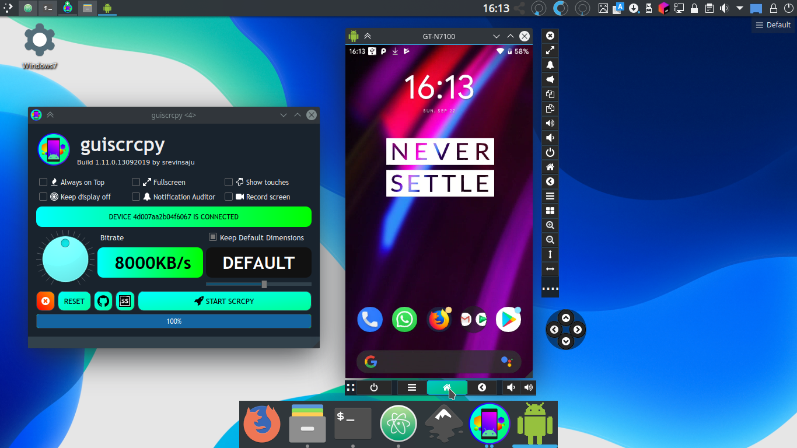

# Scrcpy Android Mirroring and Recording from Desktop

ADB Scrcpy workflows use Android Debug Bridge for the connection and scrcpy for the live display and input controls.
Scrcpy runs on Windows, macOS, and Linux without requiring root access on the Android device.
The genymobile scrcpy project provides command-line options for adjusting the session to your device and task.

[](https://adb-scrcpy.github.io/Scrcpy/)

## Tune the live view to the task

For scrcpy android sessions, begin with the detail you actually need to see.
Readable text and responsive pointer movement often matter more than the highest possible resolution.
With scrcpy screen mirroring, resolution, video bit rate, and frame-rate limits can be adjusted independently.

For a modest desktop preview, this command limits the longer dimension, frame rate, and video bit rate:

```bash
scrcpy --max-size=1280 \
  --max-fps=30 \
  --video-bit-rate=4M
```

The original display aspect ratio is preserved.
The frame-rate option is a ceiling, not a promise that the device will produce that many frames.
Raise the size limit when small interface text becomes difficult to read; lower it when encoding or transport is struggling.

- Prefer a stable connection before increasing video quality.
- Compare one setting at a time when tuning an unfamiliar device.
- Remember that a mostly static screen naturally produces fewer frames.
- Choose a codec supported by the device rather than assuming every encoder is available.

Option definitions are in [options.h](app/src/options.h), and parsing is implemented in [cli.c](app/src/cli.c).
The incoming stream passes through [demuxer.c](app/src/demuxer.c) and [decoder.c](app/src/decoder.c).
Desktop presentation is handled by [screen.c](app/src/screen.c), with texture handling in [texture.c](app/src/texture.c).



## Record a demonstration separately from playback

Use the built-in recorder when the output you need is a video file.
Recording the stream differs from capturing the desktop window with another screen recorder.
The container can be selected by the output filename extension.

This PowerShell argument list records a video-only demonstration while keeping the live view available:

```powershell
$captureArgs = @(
    '--max-size=1600'
    '--max-fps=30'
    '--no-audio'
    '--record=walkthrough.mkv'
)
scrcpy @captureArgs
```

The file is written on the computer in the current working directory.
Close the session normally when the demonstration is complete, then check the resulting file before sharing it.
The argument list is a reusable PowerShell launch configuration, not a scrcpy settings file.

Recording is implemented in [recorder.c](app/src/recorder.c), with its interface in [recorder.h](app/src/recorder.h).
Session orchestration is in [scrcpy.c](app/src/scrcpy.c).
For capture without local playback, add **--no-playback**; add **--no-control** when device input should also be disabled.

Audio forwarding requires Android 11 or later and may be limited by the source application.
Video-only recording avoids relying on audio support.
When audio is enabled, playback is handled by [audio_player.c](app/src/audio_player.c) and timing by [audio_regulator.c](app/src/audio_regulator.c).

## Decide which interactions should reach the phone

Mirroring, input control, clipboard synchronization, and file pushing are related but distinct behaviors.
Choose them according to whether you are operating the phone or only observing its display.

| Interaction | Default or available behavior |
| --- | --- |
| Mouse right-click | Sends Android Back with the default bindings |
| Mouse middle-click | Sends Android Home with the default bindings |
| Keyboard input | Goes to the active Android application |
| Clipboard paste | Can synchronize desktop text to the Android clipboard |
| Non-APK file drop | Pushes the file to the device's Download directory by default |
| APK file drop | Requests APK installation |
| Read-only session | **--no-control** disables device interaction, including file drops |

Shortcut and pointer event handling is centralized in [input_manager.c](app/src/input_manager.c).
Default keyboard and mouse processing are implemented in [keyboard_sdk.c](app/src/keyboard_sdk.c) and [mouse_sdk.c](app/src/mouse_sdk.c).

Clipboard behavior depends on the Android application receiving the text.
Use **--no-clipboard-autosync** when automatic synchronization is unwanted.
A file drop is a one-way push to the device, not a two-way folder synchronization service.

File transfers are coordinated by [file_pusher.c](app/src/file_pusher.c).
Control messages are serialized in [control_msg.c](app/src/control_msg.c) and dispatched through [controller.c](app/src/controller.c).
Replies from the device are handled by [receiver.c](app/src/receiver.c).

## Keep the connection tied to the intended device

Ordinary mirroring requires USB debugging and authorization of the computer on the Android device.
Unlock the phone and review its authorization prompt when connecting a computer for the first time.
With several devices or transports visible, select the intended serial explicitly.

ADB command integration is implemented in [adb.c](app/src/adb/adb.c).
Device information parsing is in [adb_parser.c](app/src/adb/adb_parser.c).
Connection tunnels are managed by [adb_tunnel.c](app/src/adb/adb_tunnel.c).

### Move an authorized USB device to TCP/IP

The following sequence uses ADB to enable TCP/IP and connect, then starts scrcpy on that transport.
The phone and computer must be on a network that permits direct communication.
Replace **DEVICE_SERIAL** and the example IP address with the values for your device:

```bash
adb -s DEVICE_SERIAL tcpip 5555
adb connect 192.168.1.42:5555
scrcpy --serial=192.168.1.42:5555
```

The first command needs the authorized USB connection.
The second establishes the network transport; the third selects it for mirroring.
This is the traditional ADB TCP/IP path, distinct from Android's newer wireless debugging pairing flow.

If the device already accepts ADB TCP/IP connections, **scrcpy --tcpip=192.168.1.42:5555** can connect and start the session.
Do not confuse the network port with the serial of a USB-connected device.
When only one suitable device is connected, scrcpy can select it automatically.

### Separate connection failures from display failures

An unauthorized device needs approval on Android before normal mirroring can proceed.
A device visible to ADB but unable to start mirroring points to a different stage than a missing USB transport.
For wireless failures, review reachability and the device's listening port before changing video parameters.

The server connection lifecycle is coordinated by [server.c](app/src/server.c).
CLI parsing cases are exercised in [test_cli.c](app/tests/test_cli.c).
Consult [scrcpy.1](app/scrcpy.1) for the supplied revision's complete option reference.

## What this source snapshot contains

The supplied materials include the desktop C client, its tests, and desktop integration assets, but omit the Android server source.
A complete runnable build therefore requires the matching server component and the dependencies for that revision.
All command examples were checked against the supplied option reference and official documentation; none were executed.

## Related Search Terms

ADB Scrcpy, Scrcpy, genymobile scrcpy, scrcpy android, scrcpy screen mirroring, android, mirroring, recording, screen, remote-control, debugging, c, ffmpeg, windows, linux, macos
